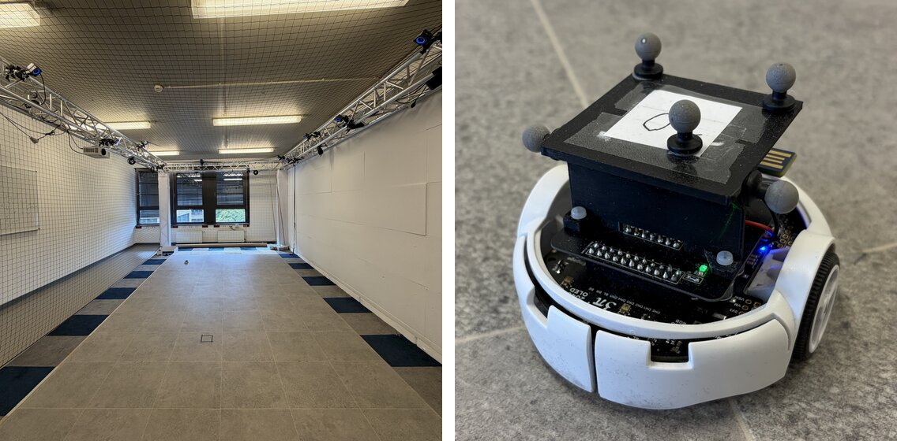
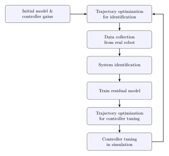
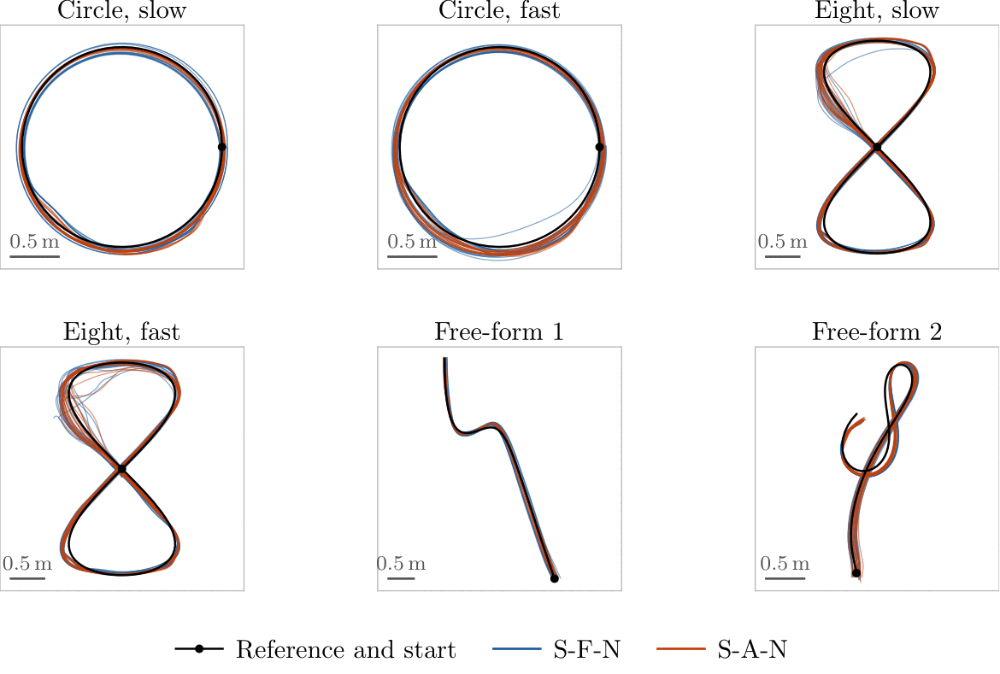
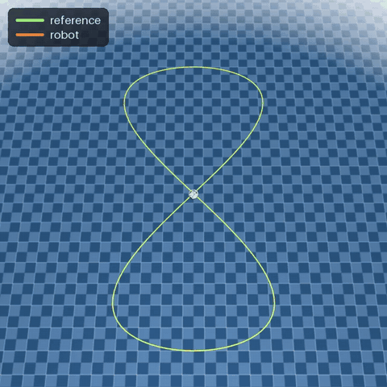

# Active Learning for Tuning Controller Parameters

A differentiable simulator and an active-learning pipeline that tunes the
trajectory-tracking controller of a small differential-drive robot (Pololu 3pi+
2040) automatically, from a deliberately wrong model and uninformed gains to a
controller that runs unchanged on the robot.

This repository is the code of the Master's thesis *Active Learning for Tuning
Controller Parameters* (Florian Rutsch, Technische Universität Berlin, 2026). The
robot firmware, including the gain-schedule network, lives in a fork of
[pololu-rs](https://github.com/frutschlori/pololu-rs/tree/experimental_gain_mlp)
(branch `experimental_gain_mlp`).
The experiment data of the thesis is available at [tubcloud](https://tubcloud.tu-berlin.de/s/wskaMEgtcJETtK2).



## The pipeline

<table>
<tr>
<td width="50%">

Every iteration of the loop:

1. **Trajectory optimization for identification.** A B-spline reference is
   optimized for the Fisher information about the robot's wheel radius and
   wheelbase (A-optimality), within the robot's motion limits.
2. **Data collection.** The reference and the current controller are copied
   to the robot's SD card and driven under motion capture. In simulation, a
   MuJoCo model of the robot with a port of the firmware control stack stands
   in for the robot.
3. **System identification** of the physical parameters (wheel radius,
   wheelbase, motor gain and time constant) from all logs, with per-log
   outlier screening.
4. **Residual model.** A small mixture-of-experts network on the body twist,
   trained on closed-loop windows of all logs so far, corrects what the
   nominal model misses.
5. **Trajectory optimization for controller tuning.** A set of tuning
   trajectories and their start offsets is optimized for the Fisher
   information about the controller gains, in the identified model.
6. **Controller tuning in simulation.** The gains of the Kanayama tracking
   controller and the wheel-speed PID are optimized with BFGS through the
   differentiable closed-loop rollout. Optionally, a gated MLP schedules the
   gains on the tracking state.

</td>
<td width="50%"></td>
</tr>
</table>

## Main Results

Every controller was evaluated on six held-out references (two circles and two
figure-eights at two speeds, two free-form curves), five chained runs each.
Configurations combine static (S) or state-dependent (D) gains, learned (A) or
fixed (F) trajectories, and the nominal plant (N) or the residual extended model (R). Position RMSE in mm, mean over the six references and
the tuned controller generations (MuJoCo: generations 1-5, median over 10
seeds; robot: generations 1-2, mean over 3 seeds):

| Configuration | MuJoCo | Robot |
|---|---:|---:|
| S-F-N (fixed trajectories) | 52.3 | 67.8 |
| S-A-N (learned trajectories) | **44.0** | 60.1 |
| S-F-R (fixed, with residual) | 53.3 | 67.0 |
| S-A-R (learned, with residual) | 44.6 | **58.4** |
| Hand-tuned stock gains | 80.9 | 124.6 |

- **The model is identified within one iteration.** From a deliberately wrong
  initial model and unit gains, the first identification corrects the four
  physical parameters, in MuJoCo and on the robot alike. The controller tuned
  on the initial model tracks at about 100 mm; after the first round of data
  the tuned gains track at 58-68 mm on the robot, without any manual
  adjustment, against 124.6 mm for the hand-tuned stock gains.
- **Learning the tuning trajectories is the one switch with a clear effect.**
  It improves the tracking by about 16 % in MuJoCo and 12 % on the robot, on
  every seed in both settings. In MuJoCo, a fixed random set of the same curve
  family that is ten times as large does not close the gap. Without start
  offsets, the tuning set carries 10 to 25 times less information about the
  gains `kx` and `ky`.
- **Learned identification trajectories, the residual model and the
  state-dependent gains show no measurable benefit on this robot.** Any
  sufficiently varied trajectory determines the four physical parameters. The
  residual changes the tracking by less than the spread between seeds. The
  gain schedule (evaluated in MuJoCo) reduces the yaw ringing, but changes the
  tracking by only about 1 mm and diverges more often.

Tracking of the six evaluation references on the robot (S-F-N against S-A-N):



A tuned controller on the fast figure-eight in the MuJoCo plant:



## Installation

Python 3.11 or 3.12 and [uv](https://docs.astral.sh/uv/):

```bash
git clone https://github.com/frutschlori/wmr-simulator
cd wmr-simulator
uv sync
uv run pytest -q
```

Everything runs on the CPU. `JAX_PLATFORMS=gpu` moves the optimizations to the
GPU, which is rarely faster for these small problems.

## Usage

**The loop in MuJoCo**, unattended for five iterations:

```bash
uv run python scripts/run_active_learning.py init --experiment experiments/exp01 --mujoco --iterations 5
uv run python scripts/run_active_learning.py run  --experiment experiments/exp01
```

Every iteration writes its own folder (`experiments/exp01/iteration_XX/`) with
the designed references, logs, identified parameters, residual model, tuned
gains, firmware exports (`ROBOTCFG.CFG`, `GAINMLP.JSN`) and plots. All
hyperparameters are in `experiments/exp01/experiment.yaml`.

**The loop on the robot.** Without `--mujoco`, `run` stops whenever robot data
is needed and prints what to copy to the SD card:

```bash
uv run python scripts/run_active_learning.py init   --experiment experiments/robot01
uv run python scripts/run_active_learning.py run    --experiment experiments/robot01
# drive the robot, copy the SD-card logs into iteration_XX/data/, then
uv run python scripts/run_active_learning.py run    --experiment experiments/robot01
uv run python scripts/run_active_learning.py status --experiment experiments/robot01
```

The mocap rigid body is calibrated against the wheel axle once per robot with
`scripts/mocap_calibration.py`. Benchmark runs on the robot go into
`iteration_XX/data/benchmark_static/<reference>/`; the open references have
bridged versions (`*_bridge.JSN`) that return to their start.
`examples/robot_run/` is a complete run of the loop on the robot
(configuration S-A-R, iterations 0 to 4) with its SD-card logs and the plots
of every stage (`iteration_XX/visualize/`):

```bash
uv run python scripts/run_active_learning.py status        --experiment examples/robot_run
uv run python scripts/run_active_learning.py plot-run-logs --experiment examples/robot_run
```

**Studies.** `scripts/run_study.py` runs several configurations over several
seeds in MuJoCo and `scripts/summarize_study.py` tabulates them, as in the
thesis evaluation:

```bash
uv run python scripts/generate_fixed_trajectory_sets.py   # fixed sets for the F configurations
uv run python scripts/run_study.py examples/study_static.yaml --max-parallel 2
uv run python scripts/run_study.py examples/study_state_dependent.yaml
uv run python scripts/summarize_study.py experiments/static_matrix
```

**Other scripts:** `run_simulation.py` (one closed-loop simulation),
`run_mujoco_deployment.py` (one run on the MuJoCo plant),
`render_deployment_video.py` (videos like the one above),
`generate_baseline_reference.py` (circles, figure-eights and other analytic
references), `pololu_append_bridge_reference.py` and `export_gain_mlp.py`
(firmware exports).

## Repository layout

```
src/wmr_simulator/
  simulation.py, robot.py, controller.py, estimator.py   differentiable closed loop (JAX)
  identification/          parameter identification from logs
  residual_model/          residual dynamics model
  trajectory_optimization/ FIM-based trajectory design (B-splines, start offsets)
  gain_tuning/             closed-loop tuning objective and optimizers
  gain_parametrization/    state-dependent gain schedule (gated MLP)
  active_learning/         the iteration loop, benchmark and studies
  mujoco_sim/              MuJoCo plant, firmware port and video rendering
  pololu/                  log decoding, smoothing and firmware exports
  visualization/           plots
scripts/                   command-line entry points
problems/pololu_gains.yaml robot, controller and estimator configuration
models/                    MuJoCo model of the robot
trajectory_exports/        evaluation references and the mocap calibration run
examples/                  a robot run and study specifications
tests/
```
